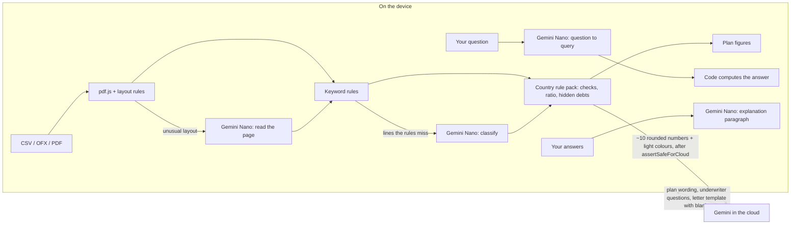

# Underwriter's Eye

**See your bank statements the way a lender will, before you apply. Your statements never leave your device.**

Before a mortgage or a rental, a lender reads your last months of bank statements line by line: overdraft fees, a deposit nobody can explain, a casino charge, a furniture payment plan that is really a loan, a debt ratio a few points too high. Most applicants find out when the file is turned down.

Underwriter's Eye runs that review first, in the browser. Gemini Nano reads the statements **on the device**, the lender's rules for your country turn them into a traffic-light report, and you get a 90-day plan, an explanation letter and answers to your own questions. The cloud model only ever sees about ten rounded numbers.

Built for the [#BuildHybridAI](https://firebasehybridaihackathon.devpost.com/) hackathon with Firebase AI Logic hybrid inference. All code was written during the contest period.

> Educational tool, not financial or legal advice. Every person, bank, employer and merchant in the samples is fictional.

## Try it in two minutes (no install, no Gemini Nano needed)

1. Open the hosted app and click **Maya - Austin, TX**, then **Analyse on this device**.
2. Read the lights, confirm or dismiss the recurring payment, move the **What if?** sliders.
3. Click **Get the underwriter's questions**, answer one, then **Write my explanation on this device**.
4. Ask a question in **Ask your statements**.
5. Click **Maya - 60 days later**, analyse again: the lights turn green.
6. Open **What left this device**: the outbound ledger shows every byte sent.

Synthetic samples may use the cloud when Gemini Nano is missing, so the whole flow works on any computer. Real statements never do (see below). To test the import path, download Maya's sample files (CSV, PDF, PDF with an unusual layout) from the same screen.

## What it does

| Feature | Where it runs |
|---|---|
| Import CSV, OFX and **PDF** statements, several accounts, transfers between them matched | Device (code + Gemini Nano for unusual PDF layouts) |
| Classify every line | Device: keyword rules first, Gemini Nano for the rest |
| Lender checks per country (US, France): debt ratio, overdrafts, large deposits, gambling, short-term credit, savings, **hidden debts** | Device (code, unit-tested) |
| What-if simulator on the debt ratio | Device (code) |
| 90-day plan with exact figures | Device computes steps and figures; Gemini in the cloud may reword them |
| Follow-up scans: before / after at day 30 and day 60 | Device |
| Underwriter interview | Cloud asks the questions from the summary; answers stay on the device |
| Explanation paragraph and letter | Gemini Nano writes the paragraph on the device; the cloud writes a template with blanks; names and amounts filled in on the device |
| Ask your statements | Gemini Nano turns the question into a query; code computes the answer |
| Works offline after the first visit | Service worker |

## How the hybrid split works



| Model call | Inference mode | Why |
|---|---|---|
| Classify lines, read PDF pages, understand questions, write the explanation: **real statements** | `ONLY_ON_DEVICE` | Raw data must never leave the device, even while Nano downloads. If Nano is missing, the app says so and keeps the rules' answer; a cloud answer for user data is treated as an error. |
| The same tasks on **synthetic samples** | `PREFER_ON_DEVICE` | Lets anyone without Nano see the whole flow. Each call is logged in the ledger. |
| Plan wording, underwriter questions, letter template | `ONLY_IN_CLOUD` | Needs a larger model; receives only the summary profile. |

Every model call is in [`src/ai/models.ts`](src/ai/models.ts).

### The models write words, the code writes numbers

- **Plan**: code decides the steps and computes the figures ("cut $141 a month or aim for housing at $1,709"). The cloud only receives the step names and must use `{{placeholders}}`; wording with a digit or a foreign placeholder is rejected ([`src/core/plan.ts`](src/core/plan.ts)).
- **PDF reading**: each line returned by Nano is kept only if its amount and its words are on the page ([`validateModelItems`](src/core/import/statement-text.ts)).
- **Questions**: Nano produces a JSON query constrained by a schema; code runs it ([`src/core/ask.ts`](src/core/ask.ts)).
- **Explanation**: a paragraph that brings a number found neither in the answers nor in the flagged lines is replaced by the user's own words ([`checkExplanation`](src/core/interview.ts)).

## Privacy guarantees

1. Labels, dates, exact amounts, account names, answers and questions never leave the device for real statements.
2. The cloud receives a `CloudProfile` ([`src/core/profile.ts`](src/core/profile.ts)): country, months covered, income and housing payment rounded to buckets, ratio in whole percent, event counts, light colours, plus enum step names.
3. [`assertSafeForCloud()`](src/core/ledger.ts) blocks any payload with an unknown key, free text or a statement label. Tested in [`tests/privacy.test.ts`](tests/privacy.test.ts) and [`tests/plan.test.ts`](tests/plan.test.ts).
4. The **outbound ledger** shows every request byte for byte, with `inferenceSource` from Firebase.
5. No analytics, no third-party fonts or scripts, nothing stored. The optional follow-up summary (the same numbers as the cloud profile) is kept in the browser only if the user ticks the box.

## Measurements

The page `/eval.html` runs a labelled set of 198 statement lines (English and French) through the rules alone, then through rules + Gemini Nano with the user-data mode (`ONLY_ON_DEVICE`), and reports accuracy, time and bytes sent.

| Run | Accuracy | On lines the rules miss | Rule coverage | Rule precision | Bytes sent |
|---|---|---|---|---|---|
| Rules only | 60.6% | - | 30.3% | 95.0% | 0 |
| Rules + Gemini Nano | *to be measured on a machine with Nano* | | | | 0 |

PDF import: the sample statements are generated, rendered to PDF and read back in the tests ([`tests/pdf.test.ts`](tests/pdf.test.ts)): every line, date and total matches.

Honest caveat: the same author wrote the keyword rules and the labelled set; about half the lines were written with wording the rules do not cover on purpose.

## Bank exports

CSV exports usually cover only the last few months, and lenders ask for the official monthly statements, which are PDFs. Both are read on the device. The CSV reader finds the header row even below a summary block, reads files with no header at all, separate debit and credit columns, unsigned amounts with a debit/credit column, and four-decimal amounts. Tested against the documented layouts of large US banks ([`tests/bank-formats.test.ts`](tests/bank-formats.test.ts), invented rows):

| Layout | Seen at |
|---|---|
| Details, Posting Date, Description, Amount, Type, Balance | Chase checking |
| Summary block, then Date, Description, Amount, Running Bal. | Bank of America |
| No header: date, amount, `*`, empty, description | Wells Fargo |
| Transaction Date, Transaction Amount (unsigned), Transaction Type, Transaction Description, Balance | Capital One 360 |
| Status, Date, Description, Debit, Credit | Citi |
| Date, Transaction, Name, Memo, Amount (four decimals) | U.S. Bank |

Layouts as documented by [beancount.io](https://beancount.io/tools/csv-to-beancount/wells-fargo), [Tiller](https://tiller.com/export-us-bank-transactions/) and others; bank names are used only to describe file layouts and appear nowhere in the app.

## Rule packs

| | United States | France |
|---|---|---|
| Statements | 2 months | 3 months, all accounts |
| Ratio | Back-end DTI on **gross** income: comfortable 36%, QM reference 43%, about 50% ceiling | Taux d'effort on **net** income: 35% (HCSF) |
| Checks | Overdraft and NSF, large deposits above 50% of monthly qualifying income ([Fannie Mae B3-4.2-02](https://selling-guide.fanniemae.com/sel/b3-4.2-02/depository-accounts)), payday loans, gambling, recurring payments that are really credit | Overdrafts and rejected debits, gambling, short-term credit, regular savings, recurring payments that are really credit |

Sources and the date each was checked are in [`src/core/rules/`](src/core/rules/). Adding a country means adding one file.

## Run it locally

Requirements: Node 24.12 or later (required by the Firebase SDK), Chrome desktop for Gemini Nano.

```bash
npm install
npm test          # 44 tests: rules, imports (CSV, OFX, PDF), transfers, hidden debts, plan, privacy, interview, questions
npm run dev       # http://localhost:5173 (and /eval.html)
```

Without Firebase configuration the app runs in **offline demo mode**: rules only, local wording, standard questions, local letter template.

### Firebase setup

1. Create a Firebase project and a Web app; enable **Firebase AI Logic** with the Gemini Developer API.
2. Enable **App Check** with reCAPTCHA Enterprise; register a debug token for localhost.
3. Copy `.env.example` to `.env.local` and fill it in.
4. `npm run build && npx firebase-tools deploy --only hosting`.

### Gemini Nano in Chrome

Open `chrome://on-device-internals` to see the model state, then click **Prepare private mode** in the app (the download must start from a click). Chrome needs about 22 GB of free disk space and either a GPU with more than 4 GB of video memory or 16 GB of RAM.

## Limits

- Rules for two countries only; thresholds are public rules of thumb, not a lender's decision.
- PDF: text PDFs only (no scanned images). Classic table layouts are read by code; other layouts need Gemini Nano.
- Gemini Nano's context is about 4k tokens: PDF pages and lines are processed in small chunks.

## License

Apache License 2.0. See [LICENSE](LICENSE).
