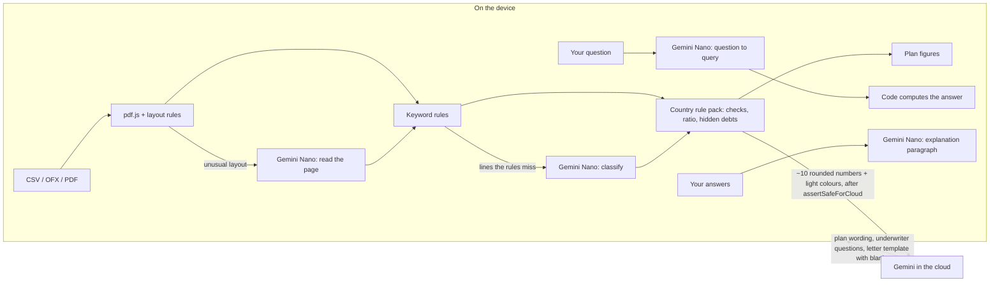

# Underwriter's Eye

**See your bank statements the way a lender will, before you apply. Your statements never leave your device.**

Before a mortgage or a rental, a lender reads your last months of bank statements line by line: overdraft fees, a deposit nobody can explain, a casino charge, a furniture payment plan that is really a loan, a debt ratio a few points too high. Most applicants find out when the file is turned down.

Underwriter's Eye runs that review first, in the browser. Gemini Nano reads the statements **on the device**, the lender's rules for your country turn them into a traffic-light report, and you get a 90-day plan, an explanation letter and answers to your own questions. The cloud model only ever sees about ten rounded numbers.

Built for the [#BuildHybridAI](https://firebasehybridaihackathon.devpost.com/) hackathon with Firebase AI Logic hybrid inference. All code was written during the contest period.

> Educational tool, not financial or legal advice. Every person, bank, employer and merchant in the samples is fictional.

## Try it in two minutes (no install, no Gemini Nano needed)

1. Open the hosted app and click **Maya - Austin, TX**, then **Analyse on this device**.
2. Read the lights, confirm or dismiss the recurring payment, move the **What if?** sliders.
3. Click **Get the underwriter's questions**, answer one, then **Write my explanation on this device**.
4. Ask a question in **Ask your statements**.
5. Click **Maya - 60 days later**, analyse again: the lights turn green.
6. Click **Diego - Denver, self-employed**: a bank statement loan computed from 12 months of deposits, a regular payment to a person to explain, two cash deposits.
7. Open **What left this device**: the outbound ledger shows every byte sent.

Synthetic samples may use the cloud when Gemini Nano is missing, so the whole flow works on any computer. Real statements never do (see below). To test the import path, download Maya's sample files (CSV, PDF, PDF with an unusual layout) from the same screen.

## What it does

| Feature | Where it runs |
|---|---|
| Import CSV, OFX and **PDF** statements, several accounts, transfers between them matched | Device (code + Gemini Nano for unusual PDF layouts) |
| Classify every line | Device: keyword rules first, Gemini Nano for the rest |
| Lender checks per country and **loan program** (US conventional, FHA, VA, bank statement loan for the self-employed; France): debt ratio, overdrafts, large deposits, gambling, short-term credit, savings, **hidden debts** and regular payments to a person, cash deposits, recent and complete statements, funds to close and reserves | Device (code, unit-tested) |
| Self-employed income from 12 months of deposits: transfers, refunds, loan proceeds and peer-to-peer excluded, expense ratio applied | Device (code + Gemini Nano to tell revenue from the rest) |
| Documents to gather for each light, and a gift letter filled in locally | Device |
| What-if simulator on the debt ratio | Device (code) |
| 90-day plan with exact figures | Device computes steps and figures; Gemini in the cloud may reword them |
| Follow-up scans: before / after at day 30 and day 60 | Device |
| Underwriter interview | Cloud asks the questions from the summary; answers stay on the device |
| Explanation paragraph and letter | Gemini Nano writes the paragraph on the device; the cloud writes a template with blanks; names and amounts filled in on the device |
| Ask your statements | Gemini Nano turns the question into a query; code computes the answer |
| Works offline after the first visit | Service worker |

## How the hybrid split works



| Model call | Inference mode | Why |
|---|---|---|
| Classify lines, read PDF pages, understand questions, write the explanation: **real statements** | `ONLY_ON_DEVICE` | Raw data must never leave the device, even while Nano downloads. If Nano is missing, the app says so and keeps the rules' answer; a cloud answer for user data is treated as an error. |
| The same tasks on **synthetic samples** | `PREFER_ON_DEVICE` | Lets anyone without Nano see the whole flow. Each call is logged in the ledger. |
| Plan wording, underwriter questions, letter template | `ONLY_IN_CLOUD` | Needs a larger model; receives only the summary profile. |

Every model call is in [`src/ai/models.ts`](src/ai/models.ts).

### Settings that change without a release: Firebase Remote Config

Three values are read at start-up from Firebase Remote Config ([`src/remote-config.ts`](src/remote-config.ts)), validated one by one ([`src/core/settings.ts`](src/core/settings.ts)), and the models are rebuilt with them:

| Parameter | Default | Use |
|---|---|---|
| `cloud_model` | `gemini-3.5-flash-lite` | The Gemini model for the cloud tasks. Must start with `gemini-`. |
| `cloud_enabled` | `true` | Kill switch. When `false`, sample files are read on the device only, and the plan, questions and letter keep their local wording. If the free-tier quota runs out, the app keeps working. |
| `clarify_max_questions` | `6` | How many "what is this line?" questions to ask (0 to 10). |

The request carries no user data: a random install ID created by Firebase, the app ID, the browser language and the SDK version. It is listed in the outbound ledger. Offline or on error, the built-in defaults apply.

### The models write words, the code writes numbers

- **Plan**: code decides the steps and computes the figures ("cut $141 a month or aim for housing at $1,709"). The cloud only receives the step names and must use `{{placeholders}}`; wording with a digit or a foreign placeholder is rejected ([`src/core/plan.ts`](src/core/plan.ts)).
- **PDF reading**: each line returned by Nano is kept only if its amount and its words are on the page ([`validateModelItems`](src/core/import/statement-text.ts)).
- **Questions**: Nano produces a JSON query constrained by a schema; code runs it ([`src/core/ask.ts`](src/core/ask.ts)).
- **Explanation**: a paragraph that brings a number found neither in the answers nor in the flagged lines, or that is written from the lender's side ("your mother"), is replaced by the user's own words ([`checkExplanation`](src/core/interview.ts)).
- **A model's guess never clears a lender check.** Only the built-in rules or the user's own answer can. On real hardware Gemini Nano read Maya's $6,000 mobile deposit as salary and her furniture instalment plan as housing, which made both flags disappear. Now a large deposit read by a model stays a deposit to explain and becomes the first question to the user, and a fixed monthly payment a model calls "housing" or "shopping" is still offered as a possible debt ([`isModelGuess`](src/core/clarify.ts), [`tests/model-guess.test.ts`](tests/model-guess.test.ts)).

## Accessibility and design

- Checked with axe-core (WCAG 2.2 AA rules): no violation, before and after a review.
- Every result is given in words and with a shape, never with colour alone; the most serious come first.
- Landmarks, a skip link, one heading per step; focus moves to the results when the review ends; progress, results and errors are announced to screen readers.
- Targets at least 44 px high; reflows to one column on a 320 px screen; respects reduced motion and Windows high-contrast mode.
- Typeface: Atkinson Hyperlegible Next and Mono, designed by the Braille Institute for low-vision readers (SIL Open Font License), bundled with the app so no request goes to a font server.

## Privacy guarantees

1. Labels, dates, exact amounts, account names, answers and questions never leave the device for real statements.
2. The cloud receives a `CloudProfile` ([`src/core/profile.ts`](src/core/profile.ts)): country, months covered, income and housing payment rounded to buckets, ratio in whole percent, event counts, light colours, plus enum step names.
3. [`assertSafeForCloud()`](src/core/ledger.ts) blocks any payload with an unknown key, free text or a statement label. Tested in [`tests/privacy.test.ts`](tests/privacy.test.ts) and [`tests/plan.test.ts`](tests/plan.test.ts).
4. The **outbound ledger** shows every request byte for byte, with `inferenceSource` from Firebase.
5. No analytics, no third-party fonts or scripts. The browser keeps only what Firebase needs (its install ID and the cached app settings) and, if the user ticks the boxes, the follow-up summary (the same numbers as the cloud profile) and the fingerprints of remembered answers.

## Learning from your answers, on the device

When the rules do not recognise a line, or Gemini Nano classifies it with low confidence (the on-device output schema carries a `confidence` field), the app asks about it, in plain words and only when the answer can change a result: large deposits, money in, and regular payments that could be a debt. Up to six questions, one per merchant ([`src/core/clarify.ts`](src/core/clarify.ts)).

- **The answer applies at once** to every line with the same name, the review is recomputed and the change in ratio and checks is announced to screen readers.
- **Learning, level 1: personal rules.** If the user ticks "Remember my answers on this browser", the merchant is stored as a SHA-256 fingerprint of its normalised name and direction, never as text. Next review, those lines are read before the model is called (source: "Your answers").
- **Learning, level 2: the on-device prompt.** The answers of the session become few-shot examples in the Gemini Nano prompt, so a similar line (another contractor, another client) is read better. They stay in memory and only ever go to the on-device model; user answers are never mixed with demo data.
- **The user has the last word on what a model guessed.** In "Every line, and who read it", any line Gemini Nano read (or the user answered) has a "What is this?" choice; the change applies to every line of the same name and the review is recomputed.
- **Answers cannot hide a risk.** Lines read by the built-in rules (betting, payday loan, overdraft fee...) cannot be relabelled, and a large deposit stays flagged whatever it is called. The lender still sees the real statement.

### Why not a shared merchant database in the cloud?

Crowd-sourcing "merchant → category" would make the app smarter for everyone, but in this version it would break the promise in [Privacy guarantees](#privacy-guarantees): a merchant name is a statement label, and the category itself can be sensitive (betting, a clinic, a payday lender). It would also need a backend and protection against poisoning. The design we would ship later, opt-in only:

1. Send only the cleaned merchant name, never an amount, date, person's name or account number; drop any label that looks like a person or a reference.
2. Randomised response on sensitive categories, so a single contribution says nothing certain about its author.
3. Use a mapping only once *k* different users agree, and never let it override a rule.
4. Ship the agreed mappings back as a read-only dictionary, so lookups stay on the device.

## Measurements

The page `/eval.html` runs labelled statement lines (English and French) through the rules alone, then through rules + Gemini Nano in the user-data mode (`ONLY_ON_DEVICE`), and reports accuracy, time, bytes sent, and how many of the model's mistakes the app turns into a question for the user.

Measured on 12 Nov 2026 with Chrome 157 and Gemini Nano on a Windows desktop (24 cores, 32 GB RAM). Nano does not give the same answer twice, so each run is listed.

**Main set** (198 lines, written with the rules; half on purpose with wording the rules do not cover):

| Run | Accuracy | On lines the rules miss | Model mistakes turned into questions | Model time | Bytes sent |
|---|---|---|---|---|---|
| Rules only | 64.1% | - | - | - | 0 |
| Rules + Nano, first prompt (2 runs) | 74.2%, 78.3% | 62.7%, 68.7% | 5 of 42 | 39 s for 134 lines | 0 |
| Rules + Nano, final (2 runs) | 80.3%, 81.8% | 71.6%, 73.9% | 6 of 35, 7 of 38 | 42 to 45 s for 134 lines | 0 |

**Held-out set** (42 lines written after the first run on real hardware, with merchants and wording found nowhere in the rules, the main set or the prompt, never used for tuning):

| Run | Accuracy | On lines the rules miss | Model mistakes turned into questions | Model time |
|---|---|---|---|---|
| Rules only | 47.6% | - | - | - |
| Rules + Nano, first prompt | 83.3% | 76.0% | 0 of 6 | 13 s for 25 lines |
| Rules + Nano, final (4 runs) | 81.0% to 85.7% | 72.0% to 80.0% | 1 to 4 of 5 to 7 | 8 s for 25 lines |

What changed between the first prompt and the final one, and why:

- **Each category is described in lender terms** in the prompt ([`src/ai/prompts.ts`](src/ai/prompts.ts)), with a rule that a payment that could be a debt is never "other". On the first run Nano answered "other" for rent, student loans and instalment plans: exactly the hidden debts a lender looks for. Words found in the held-out lines were kept out of these descriptions.
- **Code checks the direction of the money** ([`src/core/direction.ts`](src/core/direction.ts)): a café bill read as income, or a deposit read as rent, is not kept; the line becomes a question. Nano made this mistake on real hardware.
- **A model answer of "other" counts as unsure**, so it becomes a question instead of disappearing into everyday spending.

The gain is clear on the main set (about +7 points on the lines the rules miss). On the held-out set, Nano was already good with the first prompt and the change stays within run-to-run variation: the prompt was not fitted to the main set, but it did not move the held-out score either.

The other on-device tasks, checked on the same machine:

- **PDF with an unusual layout**: 50 of 50 lines read by Nano in 37 s, each checked against the page.
- **Questions in plain words**: "groceries each month" was first read by Nano as "utilities in October", and "payments to BrightHome" lost the merchant name. The words of the question now take precedence over the model's reading where they are clear ([`reconcileQuery`](src/core/ask.ts)); both questions are answered correctly, in about 2 s.
- **Explanation paragraph**: Nano writes it in about 5 s. The check that rejects numbers the user did not give was too strict ("September 5th" against a line dated 2026-09-05) and is fixed; greetings, [placeholders] and minus signs added by the model are removed.

PDF import: the sample statements are generated, rendered to PDF and read back in the tests ([`tests/pdf.test.ts`](tests/pdf.test.ts)): every line, date and total matches.

Honest caveat: the same author wrote the keyword rules, both labelled sets and the prompt. The held-out set limits, but does not remove, that bias.

## Bank exports

CSV exports usually cover only the last few months, and lenders ask for the official monthly statements, which are PDFs. Both are read on the device. The CSV reader finds the header row even below a summary block, reads files with no header at all, separate debit and credit columns, unsigned amounts with a debit/credit column, and four-decimal amounts. Tested against the six most common layouts of US checking-account exports ([`tests/bank-formats.test.ts`](tests/bank-formats.test.ts), invented rows):

| Layout | What the reader handles |
|---|---|
| Details, Posting Date, Description, Amount, Type, Balance | Signed amounts, extra trailing columns |
| Summary block, then Date, Description, Amount, Running Bal. | Header row found below a preamble |
| No header: date, amount, `*`, empty, description | Columns guessed from the content |
| Transaction Date, Transaction Amount, Transaction Type, Description, Balance | Unsigned amounts, sign taken from the type |
| Status, Date, Description, Debit, Credit | Separate debit and credit columns |
| Date, Transaction, Name, Memo, Amount | Four-decimal amounts, payee in its own column |

Layouts taken from the public documentation of import tools; every row in the tests is invented, and no bank is named in the app or the tests.

## Rule packs

US programs (pick one in the app):

| Program | Statements | Income | Ratio: comfortable / limit | Program notes |
|---|---|---|---|---|
| Conventional | 2 months, within 45 days | Gross | 36% / about 50% | Large deposits above 50% of qualifying income |
| FHA | 2 months | Gross | 43% / 50% with compensating factors | NSF fees can trigger manual underwriting |
| VA | 2 months | Gross | 41% benchmark | Above 41%, residual income 20% over the guideline |
| Bank statement loan | 12 months | Eligible deposits, minus 50% expenses for a business account (100% of deposits for a personal one) | 43% / 55% | CPA letter for a lower expense ratio |

| | United States (conventional) | France |
|---|---|---|
| Statements | 2 months | 3 months, all accounts |
| Ratio | Back-end DTI on **gross** income: comfortable 36%, QM reference 43%, about 50% ceiling | Taux d'effort on **net** income: 35% (HCSF) |
| Checks | Overdraft and NSF, large deposits above 50% of monthly qualifying income ([Fannie Mae B3-4.2-02](https://selling-guide.fanniemae.com/sel/b3-4.2-02/depository-accounts)), payday loans, gambling, recurring payments that are really credit | Overdrafts and rejected debits, gambling, short-term credit, regular savings, recurring payments that are really credit |

Sources and the date each was checked are in [`src/core/rules/`](src/core/rules/). Adding a country means adding one file.

## Run it locally

Requirements: Node 24.12 or later (required by the Firebase SDK), Chrome desktop for Gemini Nano.

```bash
npm install
npm test          # 51 tests: rules, imports (CSV, OFX, PDF), transfers, hidden debts, plan, privacy, interview, questions
npm run dev       # http://localhost:5173 (and /eval.html)
```

Without Firebase configuration the app runs in **offline demo mode**: rules only, local wording, standard questions, local letter template.

### Firebase setup

1. Create a Firebase project and a Web app; enable **Firebase AI Logic** with the Gemini Developer API.
2. Enable **App Check** with reCAPTCHA Enterprise. List only the hosted domains on the reCAPTCHA key (not `localhost`, as the Firebase guide asks) and register a debug token for local development.
   Then, following the [Firebase AI Logic production checklist](https://firebase.google.com/docs/ai-logic/production-checklist):
   - restrict the browser API key to the app's addresses (`https://<project>.web.app/*`, `https://<project>.firebaseapp.com/*`, `http://localhost:5173/*`), keeping Firebase's API restrictions;
   - turn on **AI monitoring** in AI Logic settings (it only ever sees the cloud calls, which carry the summary profile);
   - the app already requests limited-use App Check tokens, ready for replay protection.
3. Optional: in **Remote Config**, add `cloud_model`, `cloud_enabled` and `clarify_max_questions` (see above) and publish. Without a template the defaults apply.
4. Copy `.env.example` to `.env.local` and fill it in. The App Check debug token goes in `APPCHECK_DEBUG_TOKEN`, without the `VITE_` prefix: the dev server injects it, and `npm run build` fails if it would end up in the published files.
5. `npm run build && npx firebase-tools deploy --only hosting`.

### Gemini Nano in Chrome

Use Chrome on desktop, version 139 or later. If the model is not offered, turn on `chrome://flags/#prompt-api-for-gemini-nano-multimodal-input` and restart Chrome. Open `chrome://on-device-internals` to see the model state, then click **Download the on-device model** in the app (the download must start from a click). Chrome needs about 22 GB of free disk space and either a GPU with more than 4 GB of video memory or 16 GB of RAM. Tested on Chrome 157 on Windows.

Without Gemini Nano, the sample files still go through the whole flow (the cloud stands in for the on-device model, and every such call is listed in the ledger); your own statements are then read by the built-in rules only.

## Limits

- Rules for two countries only; thresholds are public rules of thumb, not a lender's decision.
- PDF: text PDFs only (no scanned images). Classic table layouts are read by code; other layouts need Gemini Nano.
- Gemini Nano's context is about 4k tokens: PDF pages and lines are processed in small chunks.
- The cloud runs on the free tier of the Gemini Developer API. Its terms ask developers not to send personal information to unpaid services, which this design respects (rounded numbers and check names only). A public launch to users in the European Economic Area, Switzerland or the UK would need the paid tier, which the Gemini API terms require there.
- Web only for now. An Android version (Gemini Nano through Firebase AI Logic) could reuse the rules and the privacy design; the TypeScript core would need porting.

## License

Apache License 2.0. See [LICENSE](LICENSE).
